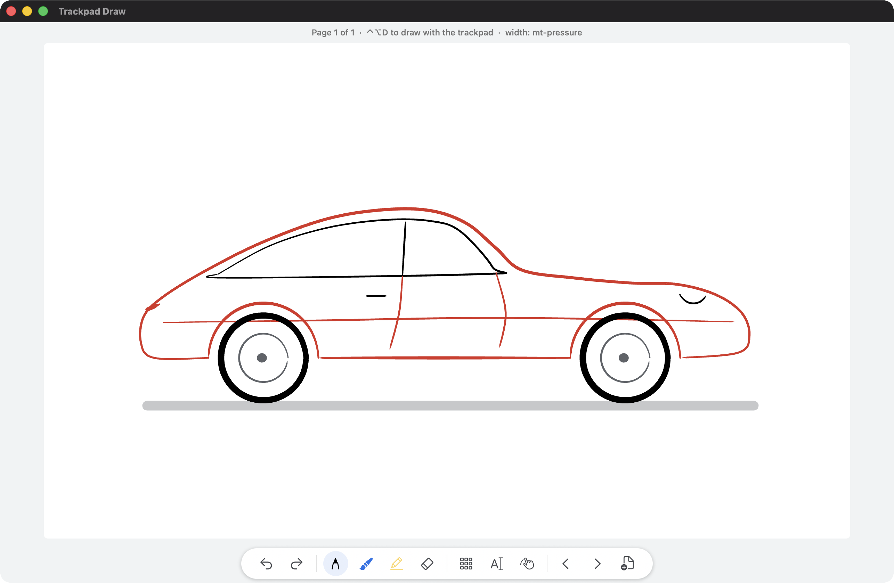

# Scrawl

Write and sketch with a finger on your Mac's trackpad. The tools follow Google Keep's drawing screen:
pen, marker, highlighter, eraser, backgrounds. Pages scroll down forever, and a writing mode pans
along your line as you write.

## Requirements

- macOS 14 Sonoma or later.
- A trackpad: the built-in one, or a Magic Trackpad.
- Apple silicon. The download also runs on Intel Macs, but nobody has tested it there yet.

## Installing

1. Download `Scrawl-<version>.dmg` from the
   [Releases](https://github.com/KarthikRaju391/trackpad-draw/releases) page. Check it against
   `SHA256SUMS.txt` if you like: `shasum -a 256 Scrawl-*.dmg`.
2. Open the DMG and drag **Scrawl** into **Applications**.
3. Open it. The app isn't notarized by Apple yet, so macOS stops it the first time:
   - **macOS 14:** Control-click (or right-click) Scrawl in Applications, choose **Open**, then
     **Open** again.
   - **macOS 15 and later:** open it once and macOS blocks it. Then go to **System Settings ›
     Privacy & Security**, scroll down to "Scrawl was blocked", click **Open Anyway** and
     confirm with your password.

   After that it opens normally. If you prefer Terminal:
   `xattr -dr com.apple.quarantine "/Applications/Scrawl.app"`.

The app needs no special permissions: no Accessibility, Input Monitoring or Screen Recording.

## Using it

- **⌃⌥D** (or **D** when the app is in front) starts drawing, and pressing it again stops.
  The paper fills the window, whatever its shape, and full screen works too (green button or ⌃⌘F). The
  trackpad (apart from a thin edge band, below) maps without distortion to the largest trackpad-shaped area
  in the window, centred. In draw mode a faint outline shows that area, and you pan to reach the rest. The pointer freezes and hides, and the
  whole trackpad becomes the visible part of the page. **Esc** gives the pointer back. So do ⌃⌥D,
  switching apps, the display sleeping, and quitting.
- **One finger** draws. **Two fingers** pan, and pinching zooms. Blue rings show where your fingers
  are, since there's no pointer.
- **Tools:** M marker, H highlighter, E eraser; press the same key again to go back to the pen.
  P picks the pen, and on the pen it goes back to the last other tool. 1–5 set the size. Tap the
  selected tool in the toolbar for sizes and colours.
- **Every mode key toggles:** D, W, A and L (or Z) turn their mode on, and pressing them again turns it off.
- **Edge guard:** touches that start within 5% of the trackpad's edges are ignored, so a resting palm
  or thumb doesn't draw, pan or zoom. A stroke that starts inside can still run to the edge. Change
  it under ⚙︎ › Edge guard (0 turns it off).
- **Writing mode (W):** pans along the line as you write, and goes to the start of the next line
  when the line is full. The page waits until your finger has been up for 0.4 s, so it never moves
  in the middle of a word. Choose the line width (½, ¾, full) and how it pans in the panel.
- **Aim first (A):** touch lightly to see where you are (an orange ring), then press to start the
  ink. Useful for maths and diagrams.
- **Zoom lock (L)** keeps the zoom fixed while two fingers still pan.
- **Pages:** N or ⌘N adds a page, ⌘[ and ⌘] move between them. Each page keeps its own view.
- **Export:** ⌘E saves every page as one PDF (vector, sharp at any size), and ⇧⌘E saves the current
  page as a PNG.
- **Help › Scrawl Help** (⌘?) lists every shortcut.

If you used it under its development name, Trackpad Draw, the first launch moves your pages and
settings over.

Everything is saved automatically, half a second after each change and when you quit. That covers
every page, its view, and undo/redo history. If the app is killed or crashes, at most the last half
second of ink is lost.

## Your data and privacy

- Pages are saved only on this Mac, in `~/Library/Application Support/Scrawl/Notebook.tdnb`.
- Nothing is uploaded and there are no analytics. The only network request is **Check for Updates**,
  which runs only when you choose it. It asks GitHub for the latest release and opens the release page
  if there's a newer one.
- Local logs live in `~/Library/Logs/Scrawl`. They note when the pointer was given back, and when
  a session ended without quitting. Touch diagnostics (raw touch data, for tuning) are off unless
  you turn on **Help › Record Touch Diagnostics**. They also stay on this Mac.
- If the app crashes, macOS's own crash reporter may offer to send a report to Apple, according to
  your Analytics settings in System Settings. Scrawl sends nothing itself.

## How the touch input works

For finger pressure, Scrawl reads the trackpad through **MultitouchSupport**, a private
macOS framework. That's why it can't be sold on the Mac App Store, and a future macOS update could
break it. If that framework is turned off or stops sending touches, the app switches to macOS's
public touch events and keeps working. Drawing still works there, but there's no pressure: line
width follows your speed, and aim-first mode is off. You can choose this yourself with **View › Use
Basic Touch Input**.

## If the pointer seems stuck

Press **Esc**, or ⌃⌥D. A small watchdog process also gives the pointer back if the app is killed or
crashes. As a last resort, quit the app from the Dock or Activity Monitor.

## Uninstalling

Delete **Scrawl** from Applications. To remove your pages and settings too, delete
`~/Library/Application Support/Scrawl` and `~/Library/Logs/Scrawl`, then run
`defaults delete com.karthikraju.scrawl`.

## Building from source

See [DEVELOPMENT.md](DEVELOPMENT.md). You need only the Command Line Tools, not Xcode: run
`./build.sh`, then `open "build/Scrawl.app"`.

## License

MIT. See [LICENSE](LICENSE). Copyright 2026 Karthik Raju.
