# Robot user: results

`make robot` runs the robot user (see [robot/README.md](../robot/README.md)) against the built app and
writes `build/robot/report.html`, with a screenshot for every step. This page records the run that
proved it catches real bugs.

## Main, build 2: 147 checks in 34 scenarios

The last full run passed 145 of 147. Two failures were test setup: a pixel threshold too strict for a thin word, and a
replay landing on the previous scenario's busy page. Both were fixed and rerun: 6/6. About 13 minutes, all in the background. Each feature in this round was proven the same way: its
scenario fails on the build before it and passes after.

| Feature | Before | After |
|---|---|---|
| Scratch-out and undo scrub | 4/8 | 8/8 |
| Writing flow: words still visible after a pan (left mode) | 1 | 2–3 |
| Writing flow: largest pan jump | 81% of the view | 47% |
| Writing flow: lines in view after a new line, with two written | 1 | 2 |
| Pan right by hand, then write (the parked pan bug) | page jumps back to the margin (x 800 → 8) | stays |
| Page map | 2/6 | 6/6 |
| Draw mode starts where you last wrote | 2/3 | 3/3 |
| Quiet draw mode | 0/5 (the banner never faded) | 5/5 |
| Toolbar and Settings | 1/5 | 6/6 |
| Tips and the practice page | 0/5 | 6/6 |
| Haptics, pending-move chevron, undo fade | 0/3 | 3/3 |
| Overview crop, titles, search, copy, share | 0/7 | 7/7 |
| Usage counts | n/a (new) | 4/4 |
| Delete page (overview Delete key, context menu, Edit › Delete Page, undo, last page, relaunch) | 4/10 | 10/10 |
| Page map only while navigating (hidden while writing, fades after a hand move) | 16/20 | 20/20; hidden during all 10 writing scenarios |
| Zoom percentage (badge, capsule, toolbar, snap, presets, typed zoom, relaunch) | 0/8 | 8/8 |
| Page map covers ink past the page's edge | map 0–1600 for ink to 1630 | map −32–1662 |

The run also covers toggles from keys and the toolbar, writing mode in every width and pan mode, double-tap
undo/redo, the eraser and a pan starting on it, pages and the overview, four window shapes, a 9,000-stroke
notebook, Karthik's recorded touch frames, and quit and relaunch.

| Measure | Before this round | Now |
|---|---|---|
| Page moves inside a word | 0 | 0 |
| Longest main-thread stall writing on a 9,000-stroke notebook | 25 ms | 26 ms (0 over 50 ms) |
| Ink jitter (checks/jitter.sh) | 0.66 pt | 0.59 pt |
| Strokes kept replaying 45 s of Karthik's touches | 60 (session kept 59) | 60 |

| | |
|---|---|
| 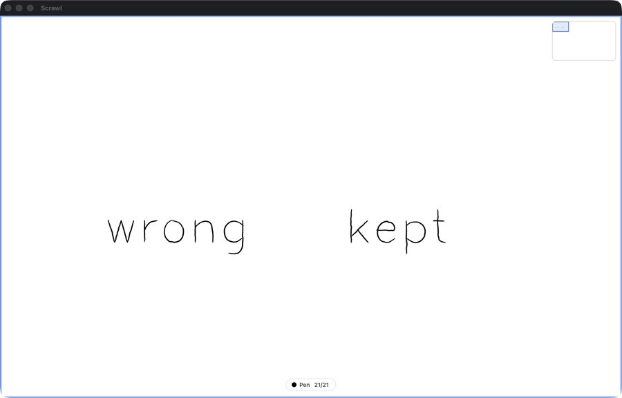 | 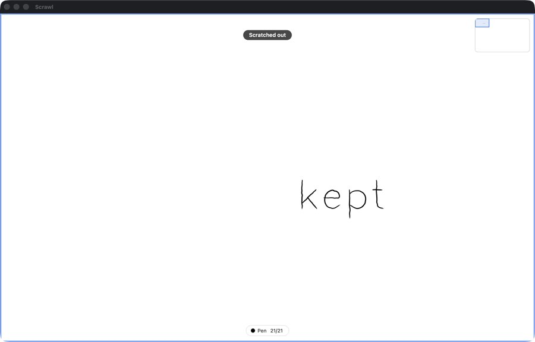 |
| 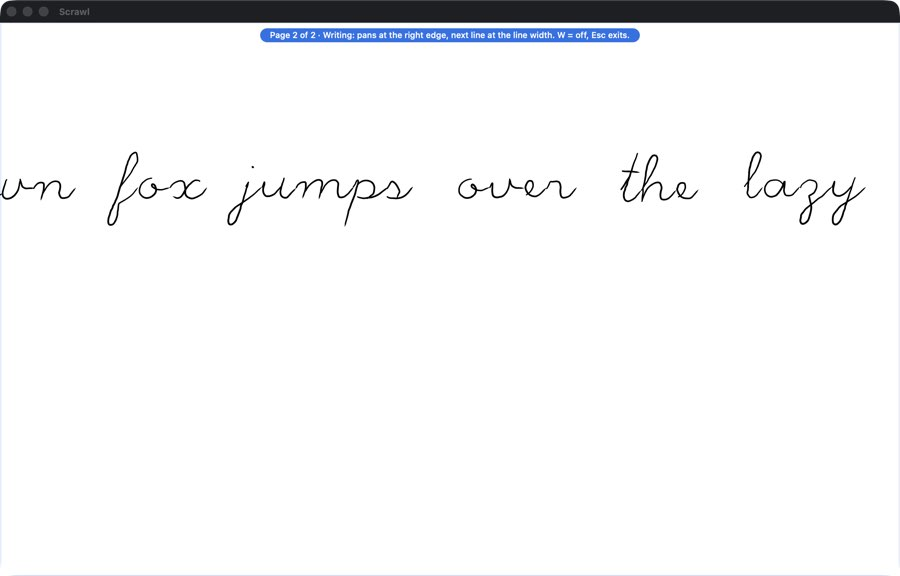 | 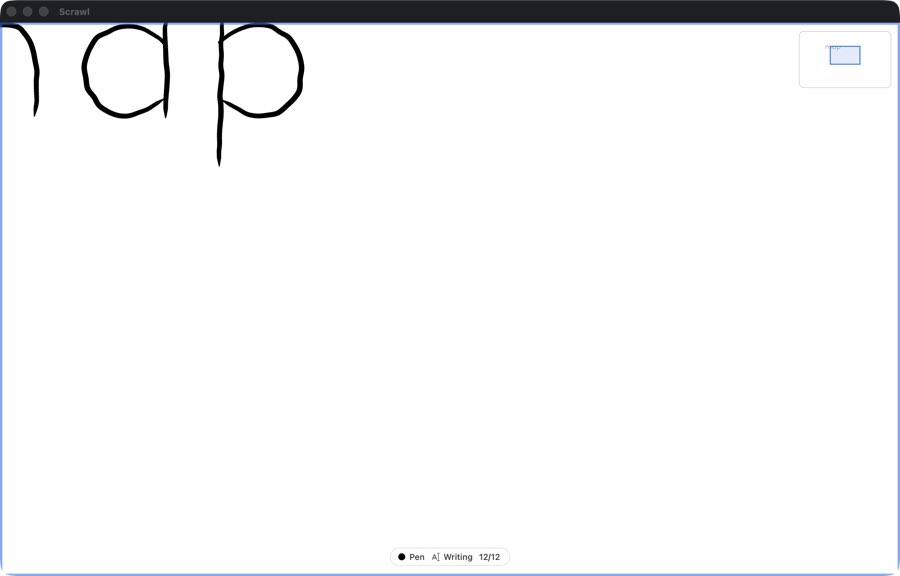 |
| 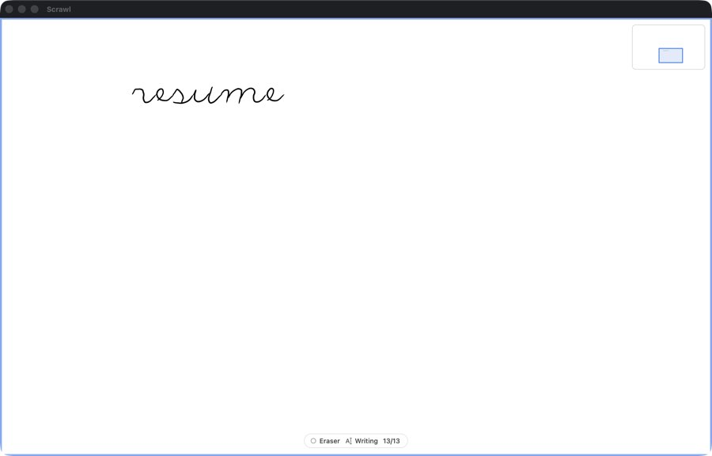 | 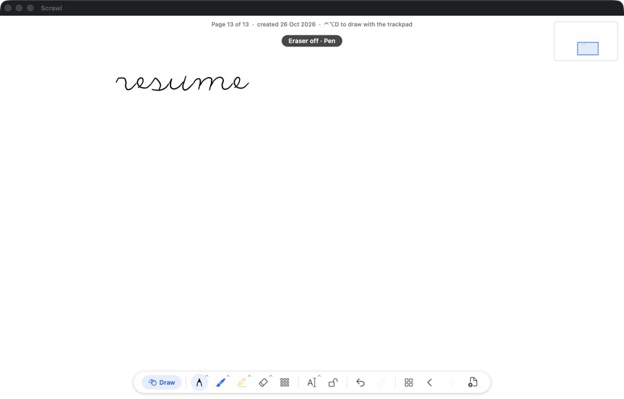 |
| 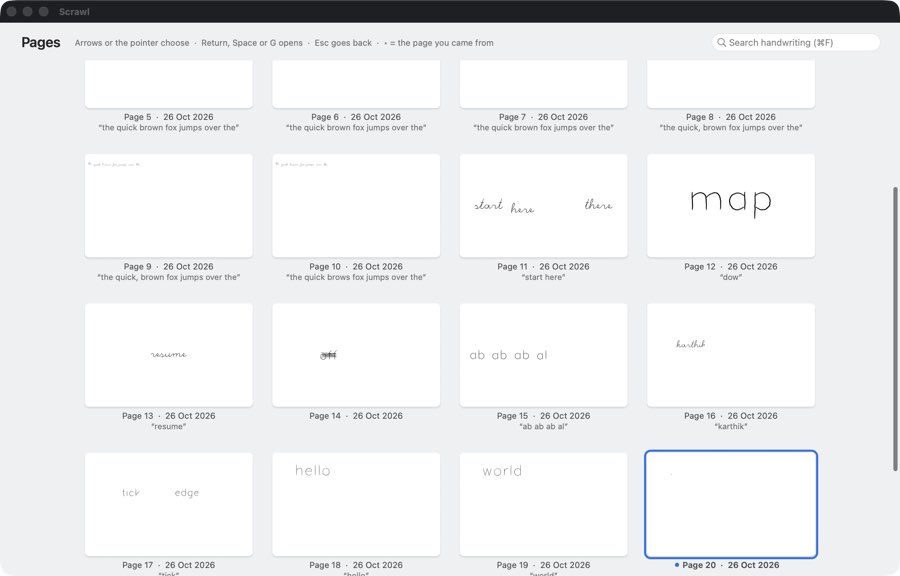 | 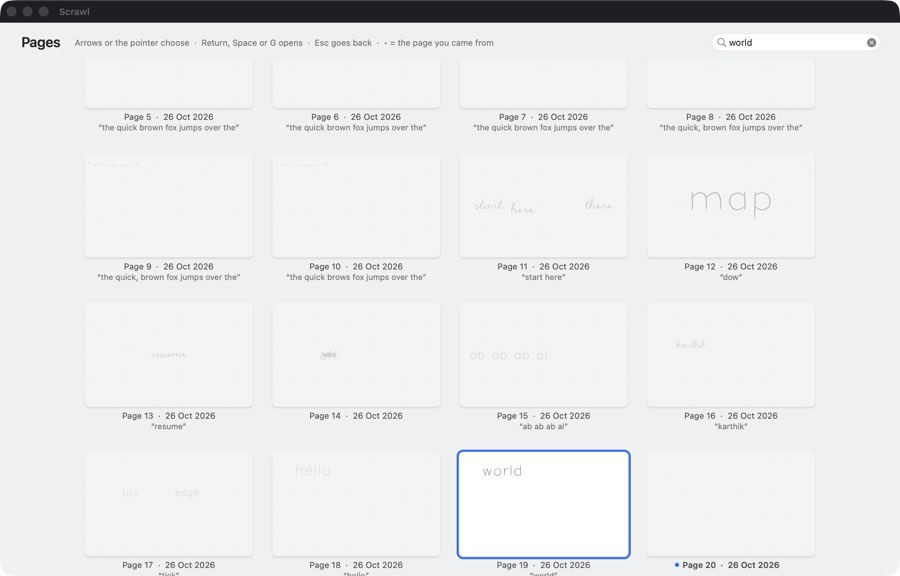 |
| 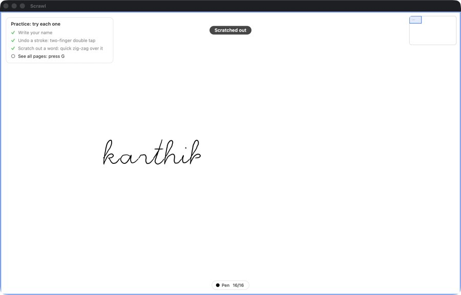 | 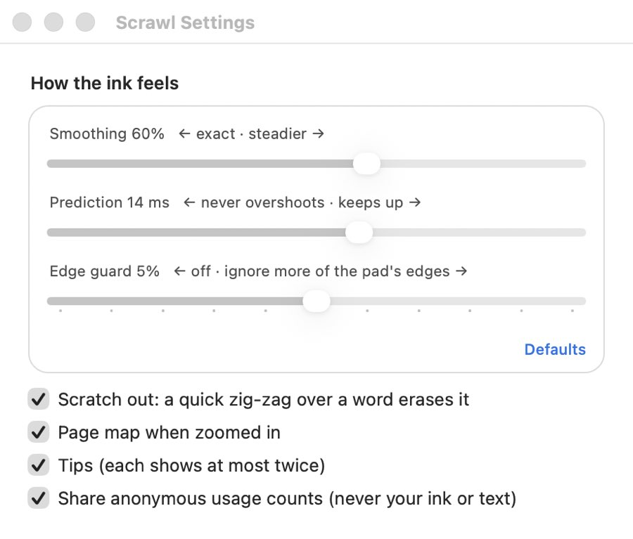 |
| 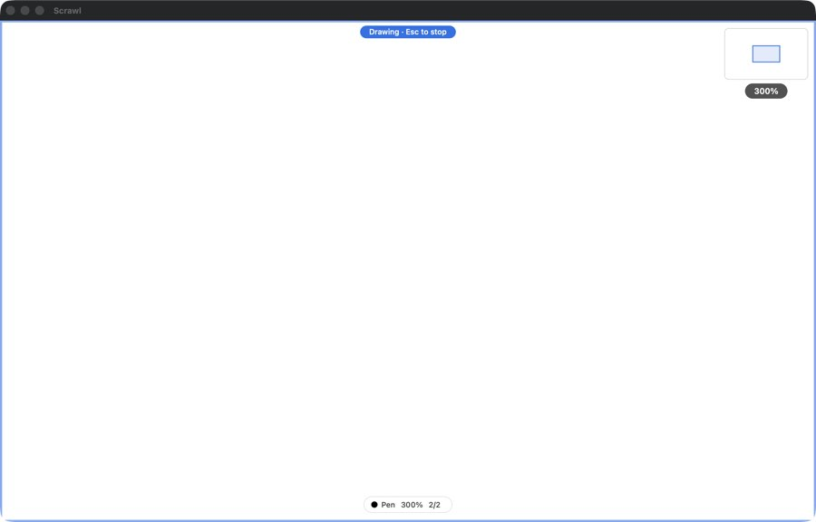 | 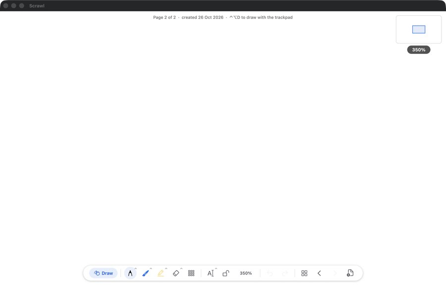 |
| 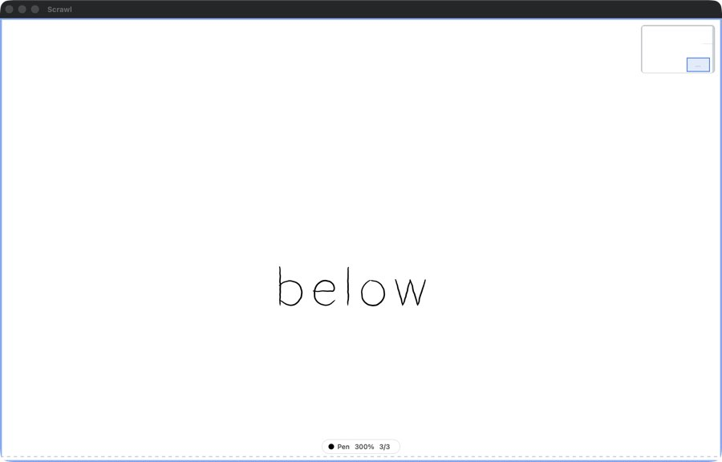 | |

## The same robot on old commits with known bugs

`robot/old-commit.sh <commit>` builds an old commit with the same robot hook and runs the same scenarios.

| Bug | Old commit | Robot on the old commit | Robot on main |
|---|---|---|---|
| The eraser erased at the start of a pan | `433b915` (fixed in `9fc7ed6`) | **FAIL**: an eraser touch followed by a two-finger pan erased a stroke (7 → 6) | pass (7 → 7) |
| Writing froze while autosave encoded on the main thread | `004c6bb` (fixed in `51326ef`) | **FAIL**: main-thread stalls up to 299 ms, 37 over 50 ms | pass: longest 25 ms, 0 over 50 ms |
| The page moved to a new line in the middle of a word | `8548c11` (fixed in `494c47d`) | **FAIL**: the page moved inside "jumps", "quick", "brown", "lazy" and "dog" | pass: 0 moves inside a word |

The old commit, mid-word moves: "jumps" is split across lines, and stray letters sit where the page moved away.

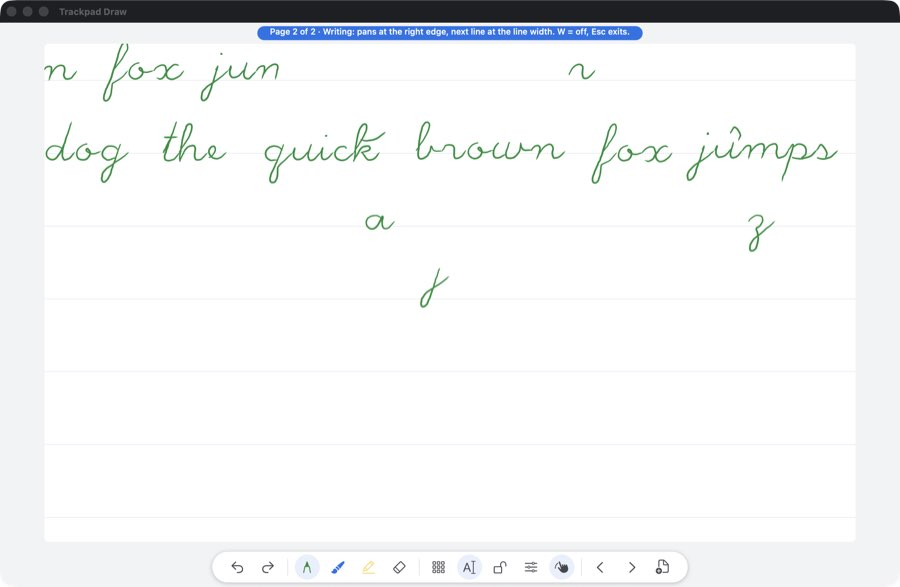

## What the numbers don't say

- **Key timings are upper bounds.** They include posting the key (about 5 ms), holding it 15 ms, polling
  (about 10 ms), and macOS delivering events to an app in the background, which it throttles. In-app click
  to frame is measured by `checks/gallery_speed.sh`: 5–35 ms.
- **No ink latency from the robot.** Its window sits behind the windows you're using, so macOS doesn't
  present its frames. Ink latency comes from `checks/e2e.sh`. The robot measures main-thread stalls
  instead; a stall is the frozen ink a user sees.
- Not covered (Karthik's hand-test list): a real finger on the trackpad (sensor noise, palms, feel), and
  macOS gestures that take touches before the app (Look Up, Mission Control, swipes between spaces).
